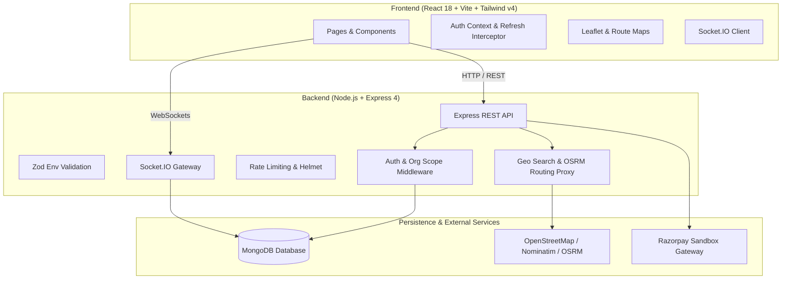

# Enterprise Carpooling Platform

[](https://github.com/organization/carpooling-platform/actions)
[](https://opensource.org/licenses/MIT)
[](https://nodejs.org/)

An enterprise-grade, multi-tenant carpooling platform designed for organizations to coordinate seamless, sustainable, and cost-effective daily employee commutes. Built with modern full-stack web technologies: React 18, Vite, Tailwind CSS v4, Express 4, MongoDB, and Socket.IO.

---

## 🏗 System Architecture



---

## 📋 Prerequisites

- **Node.js**: LTS version (v18, v20, or v22 recommended)
- **npm**: v9+ (npm workspaces support)
- **MongoDB**: v6.0+ (Local MongoDB instance or MongoDB Atlas free tier; replica set recommended for transactions)
- **Git**: v2.30+

---

## 🚀 Quick Start & Installation

### 1. Clone the repository
```bash
git clone <repository-url>
cd "car pooling system"
```

### 2. Install dependencies
Install all root, client, and server dependencies in a single step using npm workspaces:
```bash
npm install
```

### 3. Configure Environment Variables
Copy the `.env.example` templates to `.env`:

#### Server Configuration
```bash
cp server/.env.example server/.env
```
Fill in the required values in `server/.env`:
- `MONGODB_URI`: MongoDB connection string (e.g. `mongodb://127.0.0.1:27017/carpooling`)
- `JWT_ACCESS_SECRET`: Secret string for access tokens (minimum 16 characters)
- `JWT_REFRESH_SECRET`: Secret string for refresh tokens (minimum 16 characters)

#### Client Configuration
```bash
cp client/.env.example client/.env
```
Leave `VITE_API_URL` empty in development so the Vite dev proxy handles `/api` and `/socket.io`.

### 4. Run the Development Server
Starts both backend (`http://localhost:5000`) and frontend (`http://localhost:5173`) concurrently:
```bash
npm run dev
```

---

## 🗄 MongoDB Setup

### Option A: Local MongoDB Community Server (Recommended)
1. Install MongoDB Community Server from [mongodb.com](https://www.mongodb.com/try/download/community).
2. Start MongoDB service or run `mongod --dbpath <data-dir>`.
3. Set `MONGODB_URI=mongodb://127.0.0.1:27017/carpooling` in `server/.env`.

### Option B: MongoDB Atlas (Cloud)
1. Create a free M0 cluster on [MongoDB Atlas](https://www.mongodb.com/cloud/atlas).
2. Whitelist your IP address in Network Access.
3. Copy the connection string and set `MONGODB_URI` in `server/.env`.

---

## 🧪 Testing and Quality Assurance

The codebase includes end-to-end unit and integration tests with **Vitest**, **Supertest**, and **mongodb-memory-server**:

```bash
# Run tests across all workspaces
npm run test

# Run linter across all workspaces
npm run lint

# Build production client bundle
npm run build
```

---

## 🗺 Map Provider & Usage Policies

The platform uses OpenStreetMap tiles and Nominatim/OSRM proxy services:
- **Geocoding**: OpenStreetMap Nominatim. To comply with OSM usage guidelines:
  - Input searches are debounced by at least 600 ms.
  - Minimum query length is 3 characters.
  - Server proxies all requests with a custom `User-Agent`.
  - Rate limited to maximum 1 request per second.
- **Routing**: OSRM (Open Source Routing Machine). The default public endpoint is intended for development and lightweight use. For production deployments, deploy self-hosted OSRM or a commercial routing API.

---

## 💳 Razorpay Sandbox Setup

All payment features operate strictly in test/sandbox mode:
1. Register for a free account at [Razorpay](https://razorpay.com).
2. Generate API Keys in **Test Mode** from Dashboard → Settings → API Keys.
3. Configure `RAZORPAY_KEY_ID` and `RAZORPAY_KEY_SECRET` in `server/.env`.
4. Configure `VITE_RAZORPAY_KEY_ID` in `client/.env`.
5. When sandbox keys are absent, fallback simulated payments can be enabled with `ALLOW_SIMULATED_PAYMENTS=true` during development.

---

## 🔒 Security & Deployment Notes

- **Cookies**: Refresh tokens are stored in `HttpOnly` cookies. In production, serve frontend and backend behind the same reverse proxy (or configure same-site domain) to ensure first-party cookie compliance.
- **Geolocation**: Browser `navigator.geolocation` API requires an HTTPS connection outside `localhost`. Production domains must have SSL/TLS enabled.
- **Input Validation**: All inbound requests are validated through Zod schemas.
- **Data Isolation**: Organization scope middleware enforces strict tenant isolation on every database query.

---

## 🐳 Docker Deployment

A `docker-compose.yml` file provides local multi-container orchestration for the complete stack:
```bash
docker compose up --build
```

---

## 📸 Screenshots

*(To be updated as UI modules are developed in subsequent phases)*

---

## ⚠️ Known Limitations
- Current Phase: Phase 1 (Foundation). Data models, domain workflows, and UI screens will be delivered in Phases 2–8 according to `docs/MASTER_PROMPT.md`.
