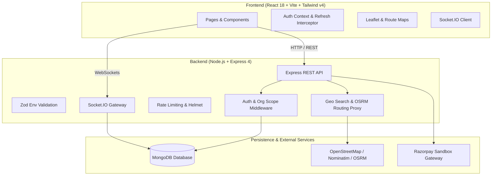

# Enterprise Carpooling Platform

[](https://github.com/organization/carpooling-platform/actions)
[](https://opensource.org/licenses/MIT)
[](https://nodejs.org/)

An enterprise-grade, multi-tenant carpooling platform designed for organizations to coordinate seamless, sustainable, and cost-effective daily employee commutes. Built with modern full-stack web technologies: React 18, Vite, Tailwind CSS v4, Express 4, MongoDB, and Socket.IO.

---

## 🏗 System Architecture



---

## 📋 Prerequisites

- **Node.js**: LTS version (v18, v20, or v22 recommended)
- **npm**: v9+ (npm workspaces support)
- **MongoDB**: v6.0+ (Local MongoDB instance or MongoDB Atlas free tier; replica set recommended for transactions)
- **Git**: v2.30+

---

## 🚀 Quick Start & Installation

### 1. Clone the repository
```bash
git clone <repository-url>
cd "car pooling system"
```

### 2. Install dependencies
Install all root, client, and server dependencies in a single step using npm workspaces:
```bash
npm install
```

### 3. Configure Environment Variables
Copy the `.env.example` templates to `.env`:

#### Server Configuration
```bash
cp server/.env.example server/.env
```
Fill in the required values in `server/.env`:
- `MONGODB_URI`: MongoDB connection string (e.g. `mongodb://127.0.0.1:27017/carpooling`)
- `JWT_ACCESS_SECRET`: Secret string for access tokens (minimum 16 characters)
- `JWT_REFRESH_SECRET`: Secret string for refresh tokens (minimum 16 characters)

#### Client Configuration
```bash
cp client/.env.example client/.env
```
Leave `VITE_API_URL` empty in development so the Vite dev proxy handles `/api` and `/socket.io`.

### 4. Run the Development Server
Starts both backend (`http://localhost:5000`) and frontend (`http://localhost:5173`) concurrently:
```bash
npm run dev
```

---

## 🗄 MongoDB Setup

### Option A: Local MongoDB Community Server (Recommended)
1. Install MongoDB Community Server from [mongodb.com](https://www.mongodb.com/try/download/community).
2. Start MongoDB service or run `mongod --dbpath <data-dir>`.
3. Set `MONGODB_URI=mongodb://127.0.0.1:27017/carpooling` in `server/.env`.

### Option B: MongoDB Atlas (Cloud)
1. Create a free M0 cluster on [MongoDB Atlas](https://www.mongodb.com/cloud/atlas).
2. Whitelist your IP address in Network Access.
3. Copy the connection string and set `MONGODB_URI` in `server/.env`.

---

## 🧪 Testing and Quality Assurance

The codebase includes end-to-end unit and integration tests with **Vitest**, **Supertest**, and **mongodb-memory-server**:

```bash
# Run tests across all workspaces
npm run test

# Run linter across all workspaces
npm run lint

# Build production client bundle
npm run build
```

---

## 🗺 Map Provider & Usage Policies

The platform uses OpenStreetMap tiles and Nominatim/OSRM proxy services:
- **Geocoding**: OpenStreetMap Nominatim. To comply with OSM usage guidelines:
  - Input searches are debounced by at least 600 ms.
  - Minimum query length is 3 characters.
  - Server proxies all requests with a custom `User-Agent`.
  - Rate limited to maximum 1 request per second.
- **Routing**: OSRM (Open Source Routing Machine). The default public endpoint is intended for development and lightweight use. For production deployments, deploy self-hosted OSRM or a commercial routing API.

---

## 💳 Razorpay Sandbox Setup

All payment features operate strictly in test/sandbox mode:
1. Register for a free account at [Razorpay](https://razorpay.com).
2. Generate API Keys in **Test Mode** from Dashboard → Settings → API Keys.
3. Configure `RAZORPAY_KEY_ID` and `RAZORPAY_KEY_SECRET` in `server/.env`.
4. Configure `VITE_RAZORPAY_KEY_ID` in `client/.env`.
5. When sandbox keys are absent, fallback simulated payments can be enabled with `ALLOW_SIMULATED_PAYMENTS=true` during development.

---

## ⚡ Real-Time Architecture & Socket.IO Events

The platform provides live GPS vehicle tracking, multi-participant trip messaging, and instant notification pushes via Socket.IO:

### Handshake & Authentication
- Socket connections authenticate using JWT access tokens provided in `handshake.auth.token`.
- Connections without valid tokens or with expired tokens are rejected with standard error codes (`TOKEN_EXPIRED`, `UNAUTHORIZED`).
- Each user automatically joins a private user room: `user:<userId>`.

### Socket Events Reference
| Event | Direction | Description |
|---|---|---|
| `trip:join` | Client → Server | Participant joins `trip:<tripId>` room. Validates driver/confirmed passenger role. Returns current trip snapshot and cached ETA. |
| `driver:location` | Client → Server | Driver emits GPS coordinates (`{ tripId, lat, lng, speed, heading }`). Throttled to 1 update/3s. The first update transitions trip from `STARTED` to `IN_PROGRESS` atomically. |
| `trip:location` | Server → Room | Broadcasts driver's latest location, heading, speed, and cached destination ETA to room `trip:<tripId>`. |
| `trip:status` | Server → Room | Broadcasts lifecycle transitions (`STARTED`, `IN_PROGRESS`, `COMPLETED`, `CANCELLED`). Automatically evicts sockets when the trip ends. |
| `chat:send` | Client → Server | Sends message (`{ tripId, text }`). Rate-limited to 10 sends/10s. Company admins blocked. Sanitized and stored in MongoDB. |
| `chat:message` | Server → Room | Broadcasts new message to `trip:<tripId>` room. If recipient is not in room, dispatches `notification:new`. |
| `chat:read` | Client → Server | Marks unread messages in trip as read by current user. |
| `notification:new` | Server → User | Pushes instant in-app notifications directly to `user:<userId>`. |

---

## 🧪 Development Tracking Simulator

For local development and testing without physical driving:
1. Ensure `NODE_ENV !== 'production'` and `ENABLE_TRACKING_SIMULATOR=true` in `server/.env`.
2. Drivers on the Tracking Page (`/trips/:id/tracking`) can click **"Simulated tracking (development only)"**.
3. Or invoke REST API:
   ```bash
   POST /api/dev/trips/:id/simulate-location
   Authorization: Bearer <driver_token>
   Content-Type: application/json
   { "stepIndex": 0 }
   ```
4. The simulator walks sequentially along the trip's stored OSRM route geometry. All emitted locations carry `simulated: true`.
5. This endpoint is strictly disabled in production mode.

---

## 🔒 Security & Deployment Notes

- **Cookies**: Refresh tokens are stored in `HttpOnly` cookies. In production, serve frontend and backend behind the same reverse proxy (or configure same-site domain) to ensure first-party cookie compliance.
- **Geolocation & HTTPS**: Browser `navigator.geolocation` API requires an HTTPS connection outside `localhost`. Production deployments must have SSL/TLS configured.
- **Admin Chat Privacy**: Company admins are strictly prohibited from viewing or sending chat messages between carpool participants.
- **Input Validation**: All inbound requests and socket payloads are validated through Zod schemas and sanitizers.
- **Data Isolation**: Organization scope middleware enforces strict tenant isolation on every database query and room.

---

## 🐳 Docker Deployment

A `docker-compose.yml` file provides local multi-container orchestration for the complete stack:
```bash
docker compose up --build
```

---

## 📸 Screenshots

*(To be updated as UI modules are developed in subsequent phases)*

---

## 🌱 Database Seeding & Demo Credentials

To populate your local MongoDB with a verified demo organization, company administrator, and sample employees:

```bash
# Seed development database
npm run seed

# Seed with employee auto-approval enabled
# (Windows CMD)
set SEED_AUTO_APPROVE=true&& npm run seed
# (PowerShell)
$env:SEED_AUTO_APPROVE='true'; npm run seed
```

> **Note**: The seed script will immediately abort if `NODE_ENV=production`.

### Seed Accounts Created:
- **Organization**: `Acme Global Technologies`
- **Registration Code**: `ACME2026`
- **Company Admin**:
  - Email: `admin@enterprise.local`
  - Password: `Admin@Pass123`
- **Sample Employees** (Password for all: `Employee@Pass123`):
  1. `priya.sharma@enterprise.local` (ID: EMP-101, Driver/Passenger)
  2. `rahul.verma@enterprise.local` (ID: EMP-102, Driver/Passenger)
  3. `sneha.patel@enterprise.local` (ID: EMP-103, Passenger)

---

## 📧 Password Reset in Development

If SMTP credentials (`SMTP_HOST`, `SMTP_USER`, `SMTP_PASS`) are not supplied in `server/.env`, the system automatically logs one-time password reset URLs directly to the server terminal console:

```
==================================================
📧 [PASSWORD RESET EMAIL] (SMTP not configured)
Recipient : user@enterprise.local
Reset URL : http://localhost:5173/reset-password?token=...
Expires   : in 1 hour
==================================================
```

Clicking or copying that URL navigates to the Reset Password interface where new credentials can be established.

---

---

## 🎨 UI Polish & Motion Design System

The platform includes a cohesive, lightweight motion system:
- **Motion Tokens**: Centralized in `client/src/index.css` covering standard durations (150ms fast, 250ms base, 400ms slow), custom cubic-bezier easings, soft elevation shadows, and micro-keyframes.
- **Micro-Interactions**: Active press scales (`active:scale-[0.97]`), hover lifts, stable-width loading spinners, and submit-error shakes.
- **Transitions**: Native-like top progress bar on navigation, route fade-in transitions, and IntersectionObserver-powered scroll reveals.
- **Live Features**: Continuous interpolated vehicle movement on Leaflet maps without abrupt jumping, live marker pulse rings, and real-time chat message slide-up animations.
- **Accessibility**: Full adherence to `prefers-reduced-motion` globally disabling animations for users sensitive to motion.

---

## ⚠️ Status & Phases
- **Current Status**: Phase 9 (UI Polish and Micro-Interactions) Completed. All core features (Authentication, Vehicles, Saved Places, Ride Matching, Bookings, Real-Time Tracking, Chat, Razorpay & Digital Wallet, Ride History, Reports, and Admin Management) are fully functional with passing test suites across client and server.

